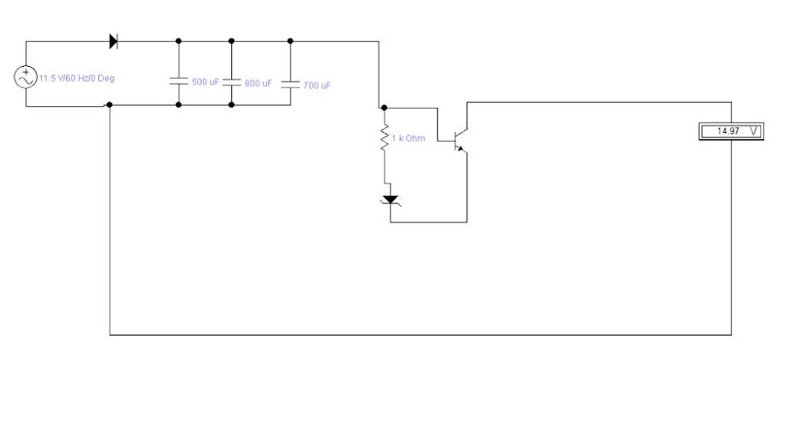

Linear Power Supply – Project Documentation

1. Project Overview

This project focuses on the design, simulation, and practical implementation of a linear power supply circuit.

The main objective is to convert an AC input voltage into a DC output voltage and investigate the circuit's ability to maintain a stable output under different operating conditions.

2. Design and Development

The circuit was independently designed and assembled by me.

Its main functional sections include:

AC input source

Rectification stage using diodes

Capacitive filtering stage

NPN transistor-based stage

Output voltage measurement

3. Components

Component

Specification

Diodes

Diode / Zener diode (exact model to be specified)

Capacitors

3 × 500 µF

Total capacitance

1500 µF, if connected in parallel

Transistor

NPN transistor (exact model to be specified)

Resistor

1 kΩ

Input source

120 V AC, 60 Hz

4. Experimental Results

During the experiment, the circuit was supplied with an AC input of:

Input voltage: 120 V AC

Frequency: 60 Hz

Phase angle: 0°

The measured DC output voltage initially reached approximately 170–173 V and gradually decreased until it stabilized at 165.8 V.

5. Voltage Behavior Analysis

The output voltage exhibited an initial decrease before reaching a relatively stable value.

The recorded voltage change was approximately 4.2–7.2 V, depending on the initial reading.

This behavior was observed during the experiment. Further testing would be required to determine the precise cause of the voltage decrease and evaluate the effectiveness of the regulation stage.

6. Observed Limitations

Delayed output voltage stabilization.

Initial output voltage variation.

Further characterization of voltage regulation and ripple is required.

7. Conclusion

This project provided practical experience in AC-to-DC conversion, rectification, capacitive filtering, and transistor-based circuit design.

The experimental results demonstrate an observable DC output and a gradual voltage change before stabilization.

Further measurements are necessary to fully characterize the circuit's regulation performance.

8. Future Improvements

More detailed output voltage characterization.

Ripple analysis using appropriate simulation or safe low-voltage measurement methods.

Improved documentation of component specifications.

Further analysis of the transistor-based stage.

## Circuit Schematic

This is the original circuit schematic designed by me.

